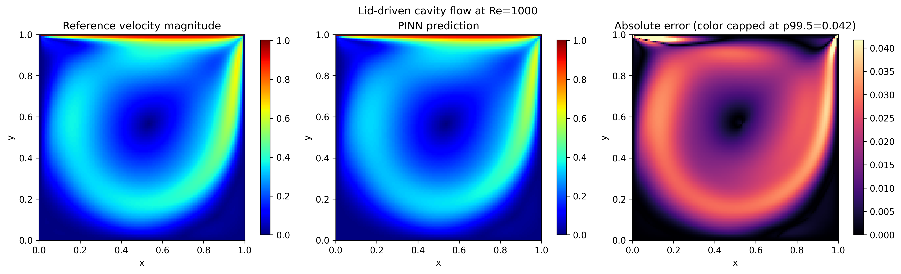

# PaddleScience LDC2D Re=1000：预测场与分区误差分析

本仓库用于复现百度飞桨 PaddleScience 的二维稳态顶盖驱动方腔流（LDC2D）Re=1000 预训练模型评估，并在官方输出之外增加：

- 参考速度模长云图；
- PINN 预测速度模长云图；
- 绝对误差云图；
- 全域、近壁区与核心区的定量指标。

> 本项目没有重新训练或修改官方 PINN。新增内容仅为可复现的后处理与空间误差诊断。官方案例与模型版权归原项目所有。



## 1. 已验证结果

本机评估使用官方 Re=1000 预训练权重，日志记录设备为 `Place(gpu:0)`。

| 指标 | 实际结果 |
|---|---:|
| 官方验证损失 `U_validator/loss` | 0.00053 |
| 官方相对 L2 误差 `U_validator/L2Rel.U` | 0.07777 |
| 后处理全域相对 L2 | 0.0777718366 |
| 全域 RMSE | 0.0229484589 |
| 全域 MAE | 0.0171952152 |

近壁区定义为距任意壁面不超过方腔边长的 10%，其余为核心区。

| 区域 | 点数 | 相对 L2 | RMSE | MAE | P99 绝对误差 | 最大绝对误差 |
|---|---:|---:|---:|---:|---:|---:|
| 近壁区 | 5,980 | 0.0769377 | 0.0250535 | 0.0118051 | 0.0495773 | 1.0028049 |
| 核心区 | 10,404 | 0.0784329 | 0.0216461 | 0.0202933 | 0.0321737 | 0.0350446 |

近壁区的 RMSE、P99 和最大误差较高，说明极值误差主要集中在壁面及顶盖角点附近；但其 MAE 和相对 L2 并不高于核心区，因此不应概括为“近壁区所有误差指标都更差”。误差图色标截断于 99.5% 分位以增强主体结构的可读性，JSON 中仍保留真实最大值。

## 2. 仓库结构

```text
.
├── analyze_re1000_error.py       # 新增的后处理脚本
├── requirements.txt              # 本次验证的核心依赖版本
├── results/
│   ├── eval.log                  # 官方评估日志
│   ├── innovation_analysis.log   # 后处理运行日志
│   ├── official_prediction_ac.png
│   ├── reference_prediction_error.png
│   └── region_metrics.json
└── README.md
```

数据集、官方模型权重和 PaddleScience 源码不提交到本仓库，由下面的命令下载。

## 3. 已验证环境

- 操作系统：Linux
- Python：3.10.12
- GPU：NVIDIA GeForce RTX 4060 Laptop GPU，8 GB 显存
- GPU Compute Capability：8.9
- Driver API：12.2
- Paddle Runtime API：11.8
- PaddlePaddle GPU：3.3.0（cu118 wheel）
- PaddleScience：`1.4.0.post1.dev1+gaeba517c2`
- PaddleScience 提交：`aeba517c2718364ea6a9e2b43b569c1b5f0cd5bb`

## 4. 安装

以下命令假设当前目录是本仓库根目录。

```bash
python3.10 -m venv cfd
source cfd/bin/activate
python -m pip install --upgrade pip
python -m pip install -r requirements.txt

git clone https://github.com/PaddlePaddle/PaddleScience.git
git -C PaddleScience checkout aeba517c2718364ea6a9e2b43b569c1b5f0cd5bb
python -m pip install -e ./PaddleScience
```

验证环境：

```bash
python -c "import paddle; paddle.utils.run_check(); print(paddle.__version__)"
python -c "import ppsci; ppsci.run_check(); print(ppsci.__version__)"
python -c "import paddle; print(paddle.device.cuda.device_count()); print(paddle.device.get_device())"
```

若只使用 CPU，请不要安装 `requirements.txt` 中的 GPU wheel，改为先执行 `python -m pip install paddlepaddle==3.3.0`，再安装其余依赖和 PaddleScience。CPU 可以复现指标，但速度和设备日志会不同。

## 5. 下载参考数据与官方权重

```bash
mkdir -p data models

wget -c -O data/ldc_Re1000.mat \
  https://paddle-org.bj.bcebos.com/paddlescience/datasets/ldc/ldc_Re1000.mat

wget -c -O models/ldc_re1000_sota_pretrained.pdparams \
  https://paddle-org.bj.bcebos.com/paddlescience/models/ldc/ldc_re1000_sota_pretrained.pdparams
```

校验下载文件：

```bash
sha256sum data/ldc_Re1000.mat models/ldc_re1000_sota_pretrained.pdparams
```

期望值：

```text
b6a135436b758ad2440495b883dc88d7accc8ea126c1f7f0e912830c33a102fc  data/ldc_Re1000.mat
0a13e7d84609e3b7179db9012be145ff250580eafa0c28edb8373844f67fc20a  models/ldc_re1000_sota_pretrained.pdparams
```

## 6. 运行官方评估

从仓库根目录执行：

```bash
cd PaddleScience/examples/ldc

../../../cfd/bin/python ldc_2d_Re3200_sota.py \
  mode=eval \
  device=gpu \
  EVAL_DATA_PATH=../../../data/ldc_Re1000.mat \
  EVAL.pretrained_model_path=../../../models/ldc_re1000_sota_pretrained.pdparams \
  hydra.run.dir=../../../outputs/official_eval

cd ../../..
```

成功时，终端日志应包含：

```text
Finish loading pretrained model from: ...ldc_re1000_sota_pretrained.pdparams
Using paddlepaddle 3.3.0 ... on device Place(gpu:0)
[Eval][Avg] U_validator/loss: 0.00053, U_validator/L2Rel.U: 0.07777
```

并生成 `outputs/official_eval/ac.png` 与 `outputs/official_eval/eval.log`。浮点末位可能因平台略有差异，但不应出现数量级变化。

## 7. 运行新增误差分析

```bash
MPLCONFIGDIR=./.mplconfig ./cfd/bin/python analyze_re1000_error.py \
  --data data/ldc_Re1000.mat \
  --weights models/ldc_re1000_sota_pretrained.pdparams \
  --output-dir outputs/innovation \
  --device gpu
```

输出文件：

- `reference_prediction_error.png`：参考场、预测场和绝对误差三联图；
- `region_metrics.json`：全域、近壁区和核心区指标；
- `velocity_fields.npz`：坐标、参考场、预测场、绝对误差和区域掩膜。

若要改变近壁宽度，例如改为边长的 5%，添加 `--near-wall-width 0.05`。报告不同阈值结果时，必须同时说明区域定义。

## 8. 常见问题

### Paddle 提示 GPU 版本已安装，但设备为 CPU

先运行 `nvidia-smi`，再检查 `python -c "import paddle; print(paddle.device.cuda.device_count())"`。IDE 沙箱、容器或远程会话可能看不到宿主机 GPU；应在能够访问 NVIDIA 设备的终端运行。

### CUDA 版本是否必须与 11.8 完全相同

本次使用的是 PaddlePaddle cu118 wheel，运行日志显示 Driver API 12.2、Runtime API 11.8。NVIDIA 驱动需满足对应 wheel 的兼容要求。若机器环境不同，应按飞桨官网选择匹配的安装源，不要机械照抄 cu118。

### 为什么最大绝对误差约为 1

最大值位于移动顶盖与静止侧壁交界附近。该位置存在边界速度不连续或极陡梯度，属于局部极值；因此同时报告 P95、P99、RMSE 和 MAE，而不是只用最大值评价全场。

## 9. 参考资料

1. [PaddleScience LDC2D_steady 官方文档](https://paddlescience-docs.readthedocs.io/zh-cn/latest/examples/ldc2d_steady/)
2. [PaddleScience GitHub 仓库](https://github.com/PaddlePaddle/PaddleScience)
3. Raissi, M., Perdikaris, P., & Karniadakis, G. E. (2019). [Physics-informed neural networks](https://doi.org/10.1016/j.jcp.2018.10.045). *Journal of Computational Physics*, 378, 686–707.
4. Wang, S., Teng, Y., & Perdikaris, P. (2021). [Understanding and Mitigating Gradient Flow Pathologies in Physics-Informed Neural Networks](https://doi.org/10.1137/20M1318043). *SIAM Journal on Scientific Computing*, 43(5), A3055–A3081.
